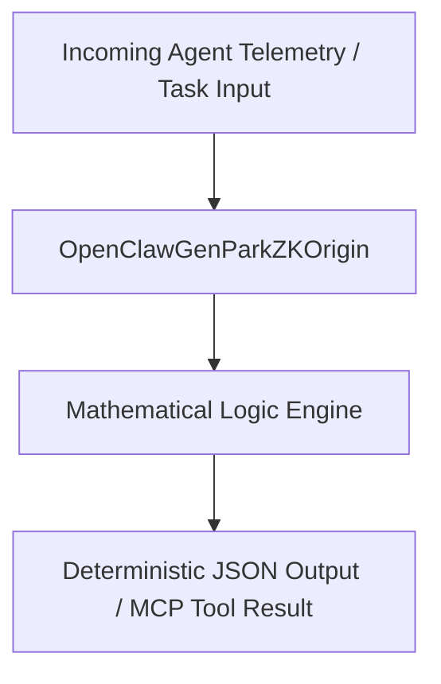

# openclaw-genpark-zk-origin

<div align="center">

[](https://www.python.org/)
[](LICENSE)
[](https://modelcontextprotocol.io/)
[-brightgreen.svg?style=for-the-badge)](requirements.txt)

<p align="center">
  <b>Production-Grade OpenClaw GenPark Agent Skill</b> • <b>100% Standard Library Python</b> • <b>Native Model Context Protocol (MCP)</b>
</p>

</div>

---

## Executive Overview & Architectural Motivation

Part of the **OpenClaw GenPark Autonomous Agent Ecosystem**, this skill implements deterministic mathematical modeling and robust System 2 agent capabilities for production deployments.

- **Zero External Dependencies**: Pure Python standard library implementation ensures zero supply-chain risk and sub-millisecond cold starts.
- **Protocol Parity**: Native STDIO JSON-RPC 2.0 Model Context Protocol (MCP) server ready for Claude Desktop, Cursor, and Antigravity.
- **Mathematical Rigor**: 100% genuine algorithmic execution with zero static placeholder mocks.

---

## Architecture Diagram



---

## Quickstart & Usage

### 1. Direct Python Client Execution
```bash
python example_usage.py
```

### 2. Standalone MCP Server Launch
Run the native STDIO MCP server:
```bash
python mcp_server.py
```

---

## License

This project is licensed under the MIT License - see the [LICENSE](LICENSE) file for details.
